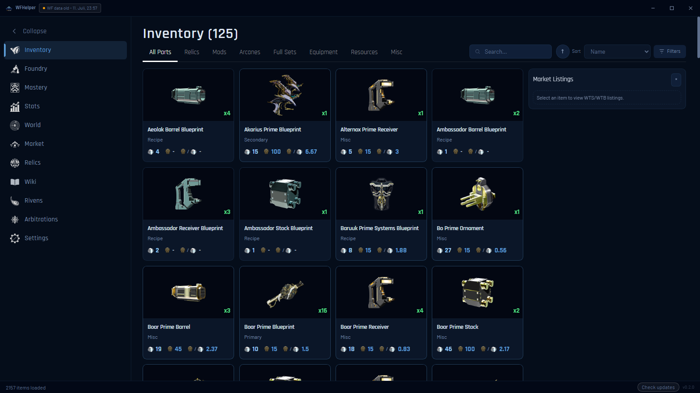

# TennoDesk

非官方的 Warframe（星际战甲）桌面助手，支持 Windows 和 Linux。它能读取你的库存并用 warframe.market 的实时价格估值、在游戏内识别遗物奖励和 Riven、管理你在 warframe.market 的买卖单，并从 EE.log 分析仲裁（Arbitration）战绩。

本项目基于 [WFHelper/WFHelper](https://github.com/WFHelper/WFHelper)（MIT 协议）修改而来，保留原作者的版权声明，见 [LICENSE](LICENSE)。感谢原作者的工作。



## 功能

应用内：

- **库存**：整个账号的物品，带白金价格、订单簿，以及武器和战甲的装备页
- **遗物**：你拥有的遗物、内容物、掉落来源和奖励
- **铸造厂**：合成所需材料，细化到每个组件
- **专精**：还没精通的物品，以及你能造什么
- **Riven**：库存里的 Riven 与市场对比、评级，**市场估价**（本分支新增），以及 Riven 查找器
- **市场**：在应用内管理 warframe.market 的买卖单（登录可选）
- **仲裁**：用 EE.log 分析每场战斗，并有带桌面通知的时间表
- **世界**：循环、裂缝、入侵、赏金和 Circuit 轮换
- **统计**：每日白金、现金和内融核心，以及交易记录
- **百科**：物品掉落位置和遗物奖励表
- **主题**：内置多套预设，也可以自定义

游戏内悬浮窗（Warframe 需使用无边框窗口模式）：

- **遗物奖励**：队友开遗物时给每个奖励标价
- **遗物规划**：在选遗物界面给你拥有的遗物排序
- **Riven 扫描**：重roll 时读取词条，对比新旧属性
- **仲裁总结**：任务结束后立刻显示战绩

> **请把 Warframe 的界面语言设为英文。** 遗物和 Riven 的扫描只识别英文物品名。本应用自己的显示语言是单独设置的，可以在设置里改成中文。

## 安装

### Windows

1. 到本仓库的 **Releases** 页面下载 `Setup.exe` 安装包并运行。
2. 安装包没有代码签名，第一次运行时 Windows SmartScreen 可能会警告：点"更多信息"，再点"仍要运行"。
3. 没有现成安装包时，可以按下文"从源码构建"自己打包或直接运行。

### Linux

下载 `.AppImage`，赋予可执行权限后运行：

```
chmod +x *.AppImage
./*.AppImage
```

Linux 上读取库存和任务追踪需要放开 ptrace、截屏需要桌面的屏幕共享入口，细节请看[上游 README 的 Linux 部分](https://github.com/WFHelper/WFHelper#linux)。

## 使用教程

### 第一次启动

1. 在设置向导里选择**语言**（支持中文）、**界面大小**和**主题**，点**下一步**。
2. 选择**库存来源**：
   - **warframe-api-helper（推荐）**：Windows 上点 **Install Helper** 自动下载，进游戏登录后会持续同步库存；已装过就点 **Load Helper Data**。首次同步可能要几分钟，之后游戏运行时每 10 分钟自动刷新。
   - **导入 inventory.json**：导入你已有的库存导出文件。
   - **导入 AlecaFrame 缓存**：选 `%LOCALAPPDATA%\AlecaFrame` 下的 `lastData.dat`。
   - **不导入库存继续**：世界、市场和各个悬浮窗仍可使用，只是"你拥有什么"相关的功能不可用。以后可以在设置里再连接。
3. **摆放悬浮窗**：向导会显示遗物奖励、遗物规划、Riven、仲裁总结四个悬浮窗的预览，把它们拖到合适位置并调整大小，位置会自动保存。以后可以在 **设置 > 悬浮窗 > 摆放悬浮窗** 里重新调整。

### 登录 warframe.market（管理订单、发布售卖需要）

不登录时，价格、估价和预览都能用。**发布售卖信息、管理你的订单需要先登录。**

1. 点左侧导航的**市场**。
2. 在登录表单填入 warframe.market 的**邮箱和密码**，点**登录**。
3. 如果你平时用 Steam 或 Discord 登录 warframe.market：先到 warframe.market 网站的账号设置里给账号设置一个密码，再用账号邮箱加这个密码登录。登录名是邮箱，不是游戏昵称。
4. 登录过期时会提示"请在市场标签页重新登录"，重新登录即可。

账号密码只用于登录 warframe.market，仓库里不包含任何账号信息。

### 管理买卖单

登录后在**市场**页可以查看自己的买卖单、改价、改数量、标记成交、隐藏或删除，也可以批量调价。游戏内完成交易后，应用能识别交易并与订单匹配。

### Riven 估价

1. 打开 **Riven** 页，库存里已解锁的 Riven 会以卡片显示，并带有单词条评级和整体评级。
2. 点单张 Riven 打开详情，顶部的**市场估价**框会显示一个估价、价格区间和可信度。
3. 点列表工具栏的**全部估价**，会逐张请求市场数据，估完后每张卡片上显示 `≈价格p`，鼠标悬停可看区间。

估价怎么算：

- 取 warframe.market 上同武器的**在线**挂单，不计离线卖家，也不计没有一口价的拍卖。
- 按词条与你的 Riven 的相似度加权，取加权中位价作为估价，区间为 25% 到 75% 分位。
- 相似度 50% 以上的挂单少于 3 条时，会放宽条件并标为低可信度。

注意：估价基于**挂牌价**，不是成交价，通常比实际成交价偏高，只作参考。

### 遗物奖励悬浮窗

保持应用运行，进入虚空裂缝任务并开遗物，奖励选项出现后稍等片刻，悬浮窗会显示每个奖励的价格。没有出现时检查 **设置 > 悬浮窗** 里的开关和**遗物触发热键**，并确认游戏界面语言为英文。

## 隐私

库存快照、仲裁日志和统计数据都保存在你自己的电脑上。应用会访问上游项目的缓存后端（warframe.market 价格、图标、新遗物数据）、公开的游戏数据源和 GitHub（检查更新）。应用没有崩溃上报或遥测。

注意：本分支沿用了上游的后端地址和更新检查配置，安装版会向上游项目检查更新。如果你自己发布这个分支，请先修改 `package.json` 里的 `build.publish`，以及 `config` 下的后端地址。

## 从源码构建

需要 Node 22.12 或更新版本，以及 pnpm 11（通过 corepack）。

```
corepack enable
pnpm install
pnpm run dev         # 开发模式
pnpm run build       # 构建
pnpm start           # 构建并启动
pnpm run dist:win    # 打包 Windows 安装程序（NSIS）
```

## 致谢

- [WFHelper](https://github.com/WFHelper/WFHelper)：本项目的上游
- [warframe.market](https://warframe.market)：价格和订单数据
- Digital Extremes 的 Public Export：物品数据和图片
- [WFCD](https://github.com/WFCD) 社区项目：物品库、掉落表和世界状态 API
- [browse.wf](https://browse.wf)：额外的物品图标
- [sves 的 arbi analyzer](https://svesk.github.io/arbi/)：仲裁统计模型
- [Sainan/warframe-api-helper](https://github.com/Sainan/warframe-api-helper)：库存快照工具
- AlecaFrame：导入功能读取的 `lastData.dat` 格式

## 免责声明

非官方的粉丝项目，与 Digital Extremes 没有关联，也未获其认可。"Warframe"及相关素材归 Digital Extremes Ltd. 所有。

## 许可证

MIT，见 [LICENSE](LICENSE)。
